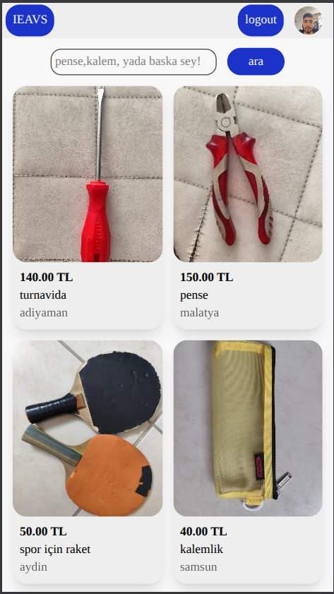
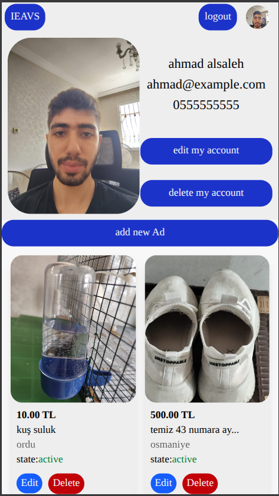
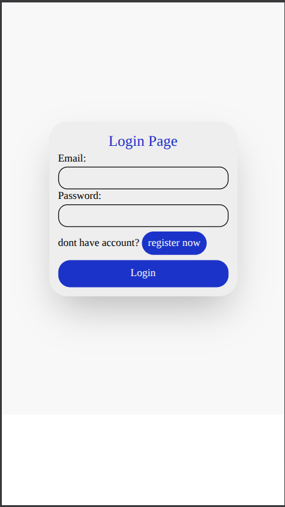
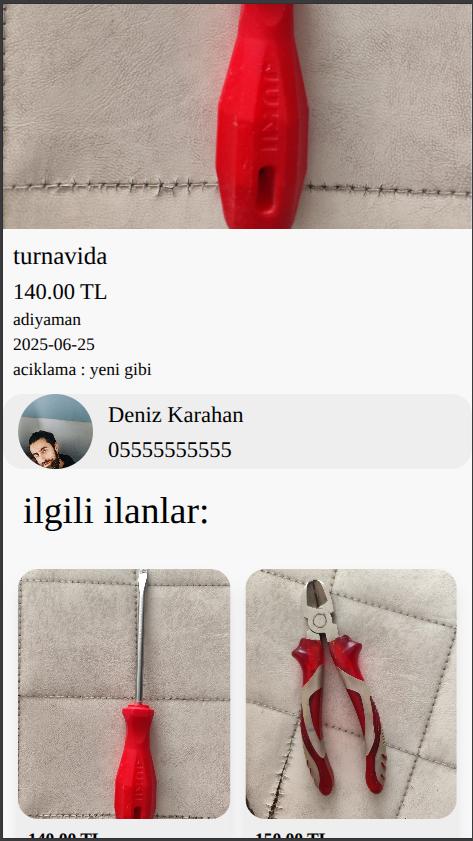

# IEAVS

A classified-ads web application (Turkey-wide: all 81 cities) built with React and TypeScript. Users register, post and manage their own ads with images, and everyone can search listings by keyword, city, and category.

## Features

**Public**
- Home page with ad feed
- Keyword search with filters (city, category)
- Individual ad detail page and public seller profile

**Authenticated (protected routes)**
- Register / login with token-based auth
- Post an ad (title, description, price, image, city, category)
- Edit or delete own ads, edit own profile
- Route guards (`PageGateWay`) redirect unauthenticated users

## Tech stack

- **React 19** + **TypeScript 6** on **Vite 8**
- **Redux Toolkit** + **React Redux** for global state (auth token, session)
- **React Router v7** — nested layouts, protected route gateways, 404 handling
- **Tailwind CSS v4** (Vite plugin) + **lucide-react** icons
- **ESLint** (typescript-eslint, react-hooks plugins)
- Consumes a REST API (`/api/authenticat/*`, `/api/me`, `/api/ads`) via a typed API layer

## Architecture

```
src/
├── App.tsx                 # route table (public / protected / auth)
├── features/
│   ├── auth/               # login, register, auth API
│   ├── public/             # home, search, ad page, user page
│   └── protected/          # post/edit ad, my ads, profile (gated)
├── components/             # layout, header, footer, search bar, guards
├── utils/                  # typed API schemas, cities/categories loaders
└── store.ts                # Redux store
```

All server payloads are typed (`src/utils/types.ts`), so API responses are checked end-to-end in the components that consume them.

## How to run

```bash
npm install
npm run dev        # start Vite dev server
npm run build      # type-check + production build
npm run lint       # ESLint
```

The app expects the REST API at `http://localhost:5000/api/` (see `src/utils/apis.ts`).

 
 
